<a id="top"></a>
<div align="center">

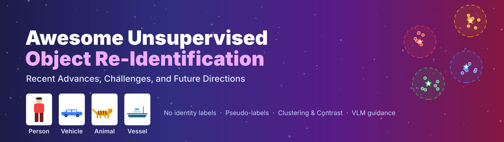

<p>
  <a href="#"></a>
  <a href="#-demo-what-is-unsupervised-object-re-id"></a>
  <a href="https://awesome.re"></a>
  <a href="#-contributing"></a>
</p>
<p>
  
  
  
  
  
</p>

**[🎬 Demo](#-demo-what-is-unsupervised-object-re-id)** ·
**[📖 Introduction](#-introduction)** ·
**[🗺️ Taxonomy](#️-taxonomy)** ·
**[📚 Papers](#-paper-list)** ·
**[🗃️ Datasets](#️-datasets)** ·
**[🔭 Future](#-future-directions)** ·
**[📝 Citation](#-citation)**

</div>

> [!NOTE]
> This repository accompanies our survey **"Unsupervised Object Re-Identification: Recent Advances, Challenges, and Future Directions"** — to our knowledge, the **first dedicated survey** of unsupervised Re-ID across **persons, vehicles, animals, and vessels**. ⭐ **Star** the repo to follow updates, and PRs are always welcome!

---

## 🔥 News

- **`2026-11`** 🎬 A 1-minute **animated demo** explaining unsupervised Re-ID is released ([MP4](fig/demo.mp4)).
- **`2026-11`** 🎉 The awesome list is released, covering **5 research areas** and **VLM-based** unsupervised Re-ID.
- **`2026-xx`** 📄 Our survey is available on [arXiv](#).

---

## 🎬 Demo: What is Unsupervised Object Re-ID?

<div align="center">

<a href="fig/demo.mp4"></a>

<sub>▶️ <b>Click the animation to download the full-resolution 1080p video</b> (<a href="fig/demo.mp4"><code>fig/demo.mp4</code></a>, 55 s)</sub>

</div>

<table>
<tr>
<td align="center" width="14%"><b>①</b><br/><sub>What is Re-ID?</sub></td>
<td align="center" width="14%"><b>②</b><br/><sub>Matching across cameras</sub></td>
<td align="center" width="14%"><b>③</b><br/><sub>The annotation bottleneck</sub></td>
<td align="center" width="16%"><b>④</b><br/><sub>Cluster → pseudo-label → train</sub></td>
<td align="center" width="14%"><b>⑤</b><br/><sub>Why it is hard</sub></td>
<td align="center" width="14%"><b>⑥</b><br/><sub>VLM guidance</sub></td>
<td align="center" width="14%"><b>⑦</b><br/><sub>Survey scope</sub></td>
</tr>
</table>

---

## 📖 Introduction

**Object Re-Identification (Re-ID)** retrieves all images of the same identity — a person, vehicle, animal, or vessel — across **non-overlapping cameras**. **Unsupervised Re-ID** learns this ability **without target-domain identity annotations**, which makes Re-ID systems scalable to new environments and privacy-sensitive deployments.

<p align="center">
  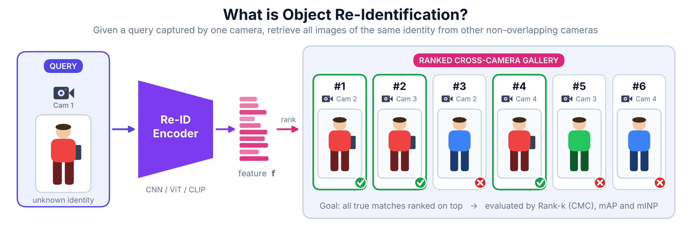
  <br/><sub><b>Fig. 1.</b> The generic object Re-ID process: a query is encoded and used to rank a cross-camera gallery.</sub>
</p>

<p align="center">
  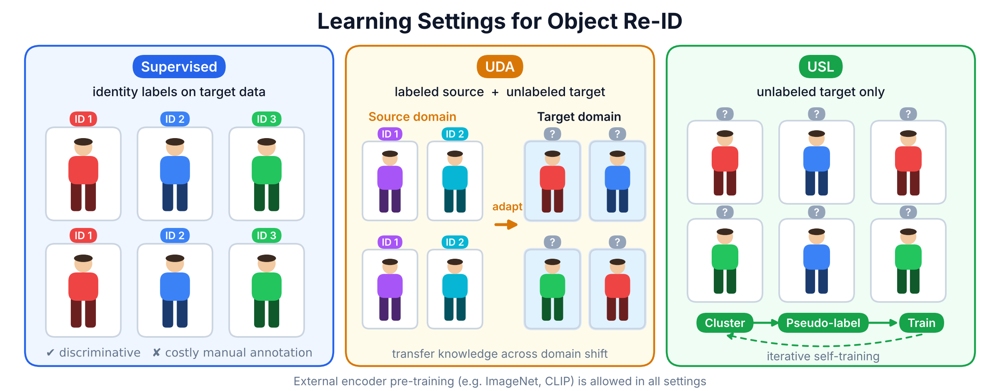
  <br/><sub><b>Fig. 2.</b> Learning settings. <b>UDA</b> uses a labeled source domain; <b>USL</b> uses no labeled Re-ID data at all.</sub>
</p>

### ✨ Highlights of this survey

<table>
<tr>
<td width="25%" align="center">🗂️<br/><b>5 Research Areas</b><br/><sub>image · video · cross-modal · scenario-specific · emerging</sub></td>
<td width="25%" align="center">🔍<br/><b>Mechanism-centric</b><br/><sub>how supervision & identity associations are built — and where they fail</sub></td>
<td width="25%" align="center">🧠<br/><b>VLM Analysis</b><br/><sub>text augmentation, prompt learning, dual-centroid experiment</sub></td>
<td width="25%" align="center">🚀<br/><b>Future Directions</b><br/><sub>VLM · multi-modality · federated · lifelong · lightweight</sub></td>
</tr>
</table>

<details>
<summary><b>📊 Comparison with existing Re-ID surveys</b> (click to expand)</summary>
<br/>

| Survey | Venue | 👤 Person | 🚗 Vehicle | 🐯 Animal | 🚢 Vessel | Focus |
|:--|:--:|:--:|:--:|:--:|:--:|:--|
| Deep Learning for Person Re-ID: A Survey and Outlook |  | ✅ | | | | General person Re-ID |
| Deep Learning for Visible-Infrared Cross-Modality Person Re-ID: A Comprehensive Review |  | ✅ | | | | Visible-infrared |
| Person Re-ID: A Retrospective on Domain Specific Open Challenges and Future Trends |  | ✅ | | | | Application challenges |
| Transformer for Object Re-Identification: A Survey |  | ✅ | ✅ | ✅ | | Transformers |
| From Attributes to Natural Language: Text-based Person Re-ID |  | ✅ | | | | Text-based retrieval |
| Vision-Language Models for Person Re-ID: A Survey and Outlook |  | ✅ | | | | VLMs |
| 🌟 **Ours** |  | ✅ | ✅ | ✅ | ✅ | **Unsupervised Re-ID** |

</details>

---

## 🗺️ Taxonomy

<p align="center">
  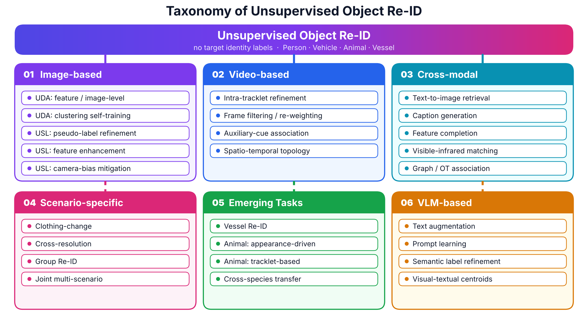
  <br/><sub><b>Fig. 3.</b> We organize unsupervised object Re-ID into five research areas plus a dedicated VLM analysis.</sub>
</p>

<p align="center">
  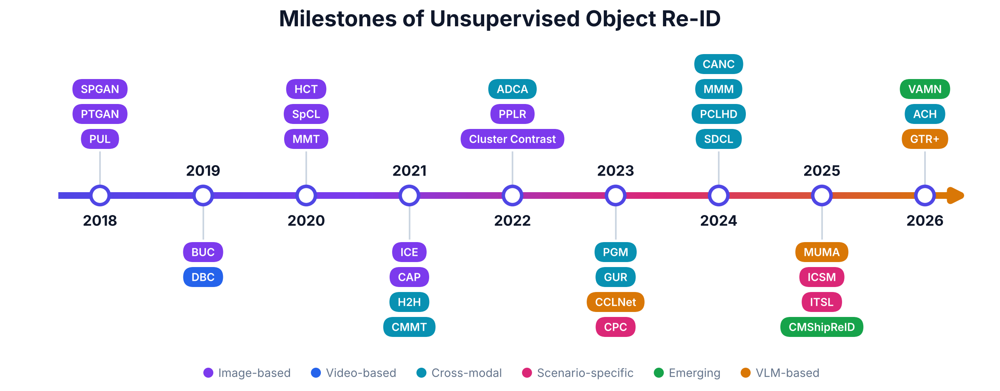
  <br/><sub><b>Fig. 4.</b> Representative milestones (2018 – 2026), colored by research area.</sub>
</p>

<p align="right"><a href="#top">🔝 Back to top</a></p>

---

## 📚 Paper List

<details>
<summary><b>🔖 Badge legend</b></summary>
<br/>

| Badge | Meaning |
|:--|:--|
|  | Top conference (CVPR / ICCV / ECCV / NeurIPS / ICLR / ICML / AAAI) |
|  | Journal (TPAMI / TIP / IJCV / PR / IF / TOMM …) |
|  | ACM MM / BMVC / ACCV / WACV |
|  | Venue to be updated |
|   | With / without labeled source Re-ID data |

</details>

### 🧱 Technical Foundations

<p align="center">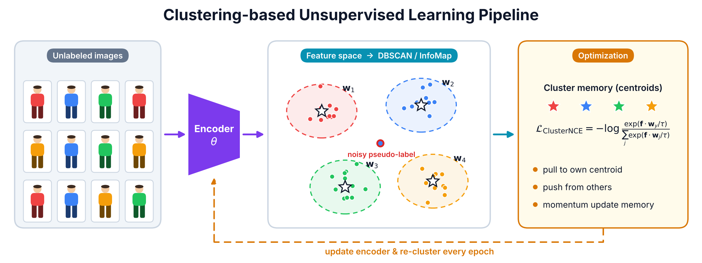</p>

| Method | Title | Venue | Code |
|:--:|:--|:--:|:--:|
| **PUL** | Unsupervised Person Re-identification: Clustering and Fine-tuning |  | – |
| **BUC** | A Bottom-up Clustering Approach to Unsupervised Person Re-identification |  | – |
| **MoCo** | Momentum Contrast for Unsupervised Visual Representation Learning |  | [](https://github.com/facebookresearch/moco) |
| **SimCLR** | A Simple Framework for Contrastive Learning of Visual Representations |  | [](https://github.com/google-research/simclr) |
| **MMT** | Mutual Mean-Teaching: Pseudo Label Refinery for Unsupervised Domain Adaptation on Person Re-identification |  | [](https://github.com/yxgeee/MMT) |
| **SpCL** | Self-paced Contrastive Learning with Hybrid Memory for Domain Adaptive Object Re-ID |  | [](https://github.com/yxgeee/SpCL) |
| **Cluster Contrast** | Cluster Contrast for Unsupervised Person Re-Identification |  | [](https://github.com/alibaba/cluster-contrast-reid) |
| **HCL** | Hybrid contrastive learning (instance + cluster) |  | – |

<details>
<summary><b>📐 ClusterNCE loss</b></summary>

$$
\mathcal{L}_{\mathrm{ClusterNCE}} = -\frac{1}{B}\sum_{i=1}^{B}\log\frac{\exp(\mathbf{f}_i\cdot\mathbf{w}_{y_i}/\tau)}{\sum_{j=1}^{C}\exp(\mathbf{f}_i\cdot\mathbf{w}_j/\tau)}
$$

where $\mathbf{f}_i$ is the $\ell_2$-normalized feature, $\mathbf{w}_j$ the $j$-th cluster prototype, $y_i$ the pseudo-label and $\tau$ the temperature.

</details>

<p align="right"><a href="#top">🔝 Back to top</a></p>

---

### 🖼️ Image-based Unsupervised Re-ID

####  Unsupervised Domain Adaptation

<p align="center">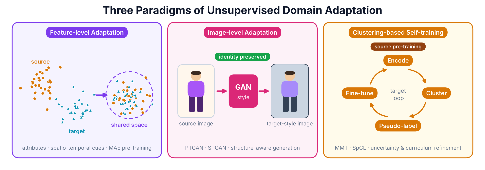</p>

<details open>
<summary><b>① Feature-level Adaptation</b></summary>
<br/>

| Method | Title | Venue | Code |
|:--:|:--|:--:|:--:|
| **MMFA** | Multi-task Mid-level Feature Alignment Network for Unsupervised Cross-Dataset Person Re-Identification |  | – |
| **TJ-AIDL** | Transferable Joint Attribute-Identity Deep Learning for Unsupervised Person Re-Identification |  | – |
| **TFusion** | Unsupervised Cross-dataset Person Re-identification by Transfer Learning of Spatial-Temporal Patterns |  | – |
| **SAM-MAE** | SAM-driven MAE pre-training for identity-sensitive regions |  | – |
| **F2TD-ReID** | Transitional representations via dictionary fusion |  | – |

</details>

<details open>
<summary><b>② Image-level Adaptation</b></summary>
<br/>

| Method | Title | Venue | Code |
|:--:|:--|:--:|:--:|
| **PTGAN** | Person Transfer GAN to Bridge Domain Gap for Person Re-Identification |  | – |
| **SPGAN** | Image-Image Domain Adaptation with Preserved Self-Similarity and Domain-Dissimilarity for Person Re-ID |  | – |
| **HHL** | Generalizing A Person Retrieval Model Hetero- and Homogeneously |  | – |
| **IPES-GAN** | Identity / environment disentangled translation |  | – |
| **TAL-MIRN** | Geometry-constrained identity-consistent translation |  | – |
| **DREAMT** | GAN translation + cross-branch mutual learning |  | – |
| **DAPRH** | Multi-style synthesis for pseudo-label refinement |  | – |

</details>

<details open>
<summary><b>③ Clustering-based Self-training</b></summary>
<br/>

| Method | Title | Venue | Code |
|:--:|:--|:--:|:--:|
| **MMT** | Mutual Mean-Teaching: Pseudo Label Refinery for UDA on Person Re-ID |  | [](https://github.com/yxgeee/MMT) |
| **SpCL** | Self-paced Contrastive Learning with Hybrid Memory |  | [](https://github.com/yxgeee/SpCL) |
| **UCF** | Uncertainty-aware clustering framework |  | – |
| **TRSL** | Curriculum-based reliable self-training |  | – |
| **DMD** | Multi-branch cooperation against noisy labels |  | – |
| **PDBN** | Multi-branch noise-robust learning |  | – |
| **CaCL** | Camera-aware curriculum learning |  | – |
| **TDSR** | Transformer-based self-training |  | – |
| **MATNet** | Transformer for fine-grained discrimination |  | – |
| **IDENet** | Inter-domain balancing framework |  | – |
| **Fed-UDA** | Federated UDA without centralizing raw images |  | – |

</details>

####  Unsupervised Learning

<details open>
<summary><b>① Pseudo-Label Generation & Optimization</b></summary>
<br/>

| Method | Title | Venue | Code |
|:--:|:--|:--:|:--:|
| **BUC** | A Bottom-up Clustering Approach to Unsupervised Person Re-identification |  | – |
| **HCT** | Hierarchical Clustering with Hard-batch Triplet Loss for Person Re-identification |  | – |
| **ICE** | ICE: Inter-instance Contrastive Encoding for Unsupervised Person Re-identification |  | [](https://github.com/chenhao2345/ICE) |
| **RLCC** | Refining Pseudo Labels with Clustering Consensus over Generations for Unsupervised Object Re-ID |  | – |
| **ISE** | Implicit Sample Extension for Unsupervised Person Re-Identification |  | – |
| **PPLR** | Part-based Pseudo Label Refinement for Unsupervised Person Re-identification |  | [](https://github.com/yoonkicho/PPLR) |
| **Plug-in Graph** | KNN-graph-based pseudo-label refinement |  | – |
| **Real-time Memory** | Real-time memory updating for clustering–contrast alignment |  | – |
| **Confidence-guided** | Silhouette-score-guided centroid selection |  | – |

</details>

<details open>
<summary><b>② Feature Representation Enhancement</b></summary>
<br/>

| Method | Title | Venue | Code |
|:--:|:--|:--:|:--:|
| **TMGF** | Transformer Based Multi-Grained Features for Unsupervised Person Re-Identification |  | – |
| **Multi-Expert** | Multi-expert feature aggregation |  | – |
| **Discriminative** | Identity-focused discriminative feature learning |  | – |
| **Joint Local Attn.** | Local attention for USL Re-ID |  | – |
| **Multi-scale Attn.** | Multi-scale attention for USL Re-ID |  | – |
| **DSG** | Disentangled sample guidance |  | – |
| **Gen-Aug** | Generative positive-pair augmentation |  | – |
| **VL-Graph** | Vision-language constraint graph learning |  | – |
| **Large-scale Sampling** | Sampling strategies for USL Re-ID |  | – |
| **Dual Distill** | Multi-view pseudo-label knowledge distillation |  | – |
| **TCRL** | Triplet cluster representation learning |  | – |
| **ACSA** | Mask-guided asymmetric contrast & distribution alignment |  | – |
| **AF2MA** | Regional fusion + instance/cluster memory augmentation |  | – |

</details>

<details open>
<summary><b>③ Camera Bias Mitigation</b></summary>
<br/>

| Method | Title | Venue | Code |
|:--:|:--|:--:|:--:|
| **SSL** | Unsupervised Person Re-identification via Softened Similarity Learning |  | – |
| **CAP** | Camera-aware Proxies for Unsupervised Person Re-Identification |  | – |
| **CCIO** | Camera-aware online K-reciprocal mining |  | – |
| **Hier. Contrast** | Hierarchical camera-aware contrastive learning |  | – |
| **CGMAL** | Camera-aware graph propagation |  | – |
| **FedCAPR** | Federated camera-aware proxy refinement |  | – |

</details>

<p align="right"><a href="#top">🔝 Back to top</a></p>

---

### 🎞️ Video-based Unsupervised Re-ID

| Method | Title | Venue | Type |
|:--:|:--|:--:|:--:|
| **RACE** | Robust Anchor Embedding for Unsupervised Video Person Re-Identification in the Wild |  | 🎯 Intra-tracklet |
| **DBC** | Dispersion based Clustering for Unsupervised Person Re-identification |  | 🎯 Intra-tracklet |
| **TASTC** | Camera topology & spatio-temporal constraints |  | 🧭 Auxiliary cue |
| **NHAC** | Dynamic frame filtering & re-weighting |  | 🎯 Intra-tracklet |
| **SRC** | Noisy-frame trimming & re-weighting |  | 🎯 Intra-tracklet |
| **MCGA** | Multi-context grouped attention |  | 🎯 Intra-tracklet |
| **SCC** | Successive clustering consensus |  | 🎯 Intra-tracklet |
| **VLUReID** | Vision-language pretraining for video Re-ID |  | 🧭 Auxiliary cue |
| **DRMPCL** | Discrepant prototypes + progressive contrast |  | 🎯 Intra-tracklet |
| **SSR-C** | Sub-tracklet relation-based cluster refinement |  | 🎯 Intra-tracklet |
| **UMTF** | Visual features + wireless positioning trajectories |  | 🧭 Auxiliary cue |
| **Wang et al.** | Spatio-temporal co-occurrence & group movement |  | 🧭 Auxiliary cue |

<p align="right"><a href="#top">🔝 Back to top</a></p>

---

### 🔀 Cross-modal Unsupervised Re-ID

<p align="center">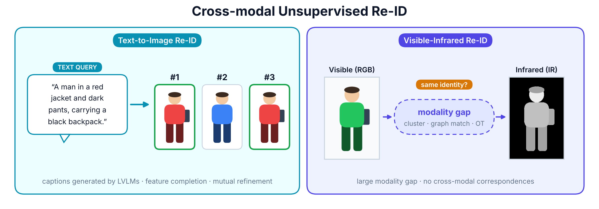</p>

#### 📝 Text-to-Image Re-ID

| Method | Title | Venue | Type |
|:--:|:--|:--:|:--:|
| **CMMT** | Weakly Supervised Text-based Person Re-Identification |  | 🔗 Paired data |
| **CANC** | CLIP-based cross-modal neighbor completion |  | 🧩 Completion |
| **ECCA** | Graph-enhanced completion & alignment |  | 🧩 Completion |
| **CCL** | Contrastive completion learning |  | 🧩 Completion |
| **WIN** | Multi-granularity reciprocal-neighbor completion |  | 🧩 Completion |
| **MUMA** | Multi-grained LVLM captions + uncertainty filtering |  | ✍️ Caption gen. |
| **GTR+** | Generative description refinement + confidence weighting |  | ✍️ Caption gen. |

#### 🌗 Visible-Infrared Re-ID

<details open>
<summary><b>① Pseudo-Label Learning with Clustering & Contrast</b></summary>
<br/>

| Method | Title | Venue | Code |
|:--:|:--|:--:|:--:|
| **ADCA** | Augmented Dual-Contrastive Aggregation Learning for Unsupervised Visible-Infrared Person Re-ID |  | [](https://github.com/yangbincv/ADCA) |
| **DCCL** | Dual-consistency collaborative learning |  | – |
| **SDCL** | Shallow-Deep Collaborative Learning for Unsupervised Visible-Infrared Person Re-ID |  | – |
| **PCLHD** | Learning Commonality, Divergence and Variety for Unsupervised Visible-Infrared Person Re-ID |  | – |
| **RPNR** | Robust Pseudo-label Learning with Neighbor Relation for Unsupervised VI-ReID |  | – |
| **PCM** | Part-based cross-modal learning |  | – |
| **APPD** | Adaptive neighbor-relation calibration |  | – |
| **PBE** | Part-based enhancement |  | – |
| **DCM** | Multi-level dual-stream camera/modality learning |  | – |
| **RoDE** | Robust duality learning |  | – |
| **ADAL** | Evolutionary optimization for USL-VI-ReID |  | – |
| **ACH** | Adaptive confidence & cross-modal hard mining |  | – |

</details>

<details open>
<summary><b>② Structure-aware Matching & Refinement</b></summary>
<br/>

| Method | Title | Venue | Code |
|:--:|:--|:--:|:--:|
| **H2H** | Homogeneous-to-Heterogeneous: Unsupervised Learning for RGB-Infrared Person Re-ID |  | – |
| **PGM** | Unsupervised VI-ReID via Progressive Graph Matching and Alternate Learning |  | – |
| **GUR** | Towards Grand Unified Representation Learning for Unsupervised VI-ReID |  | [](https://github.com/yangbincv/GUR) |
| **MBCCM** | Efficient Bilateral Cross-Modality Cluster Matching for Unsupervised VI-ReID |  | – |
| **DOTLA** | Optimal-transport prototype alignment |  | – |
| **CHCR** | Cross-modal hierarchical clustering |  | – |
| **MMM** | Multi-Memory Matching for Unsupervised Visible-Infrared Person Re-ID |  | – |
| **BCGM** | Bidirectional consistency graph matching |  | – |
| **DLM** | Dual neighbor-based label matching |  | – |
| **RULN** | Relieving label noise via neighbor inference |  | – |
| **ECUL** | Extended cross-modal unified learning |  | – |
| **SSRL** | Body-part cues with reconstructed shared prototypes |  | – |
| **HiTPro** | Hierarchical temporal prototypes (video VI-ReID) |  | – |

</details>

<details open>
<summary><b>③ Auxiliary Priors & Semantic Guidance</b></summary>
<br/>

| Method | Title | Venue | Code |
|:--:|:--|:--:|:--:|
| **CCLNet** | Unveiling the Power of CLIP in Unsupervised Visible-Infrared Person Re-ID |  | – |
| **SCA-RCP** | Camera-aware inter-/intra-modality learning |  | – |
| **CMAM** | Asymmetric mutual learning via grayscale coupling |  | – |
| **TGMRL** | Text-guided multimodal representation learning |  | – |
| **CEIL** | Camera-aware invariance learning |  | – |
| **HCCL** | Hierarchical centrality consistency learning |  | – |
| **TokenMatcher** | Token-level cross-modal matching |  | – |

</details>

<p align="right"><a href="#top">🔝 Back to top</a></p>

---

### 🎭 Scenario-specific Unsupervised Re-ID

<p align="center">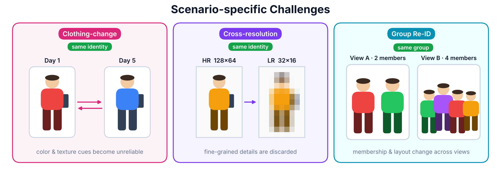</p>

<table>
<tr>
<th width="33%">👕 Clothing-Change</th>
<th width="33%">🔍 Cross-Resolution</th>
<th width="33%">👥 Group</th>
</tr>
<tr valign="top">
<td>

- **CPC** · Unsupervised Long-Term Person Re-ID with Clothes Change · 
- **SiCL** · Silhouette-driven contrastive learning · 
- **CICL** · Clothing-invariant contrastive learning · 
- **ICSM** · Identity-clothing similarity modeling · 
- **JAPL** · Joint augmentation & part learning · 

</td>
<td>

- **DRFM** · Dual-resolution feature fusion with SR · 
- **ITSL** · Image-text semantic learning · 
- **RLIM** · Robust labeling & resolution-cluster consistency · 
- **ITKM** · Scenario-conditioned image-text joint learning · 

</td>
<td>

- **Mei et al.** · Supervised predecessor (background) · 
- **Yu et al.** · Patch-based camera-aware + modified Hausdorff · 
- **Chen et al.** · Adaptive clustering with quasi-distance vectors · 
- **Chen et al.** · Strategic member harmonization (aerial) · 

</td>
</tr>
</table>

<p align="right"><a href="#top">🔝 Back to top</a></p>

---

### 🐾 Emerging Tasks

<p align="center">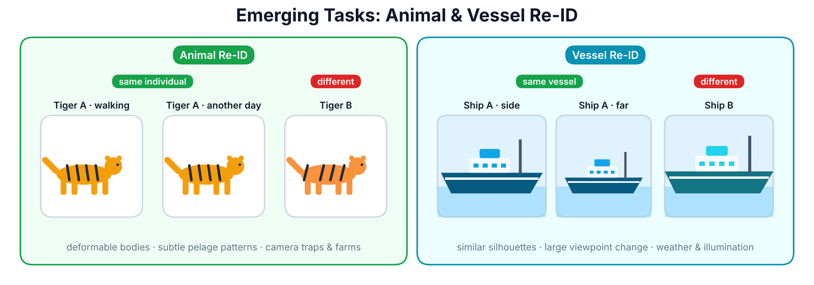</p>

#### 🚢 Vessel Re-ID

| Method | Title | Venue | Setting |
|:--:|:--|:--:|:--:|
| **MCL** | Multi-level contrastive learning (VesselReID) |  |  |
| **IMCL** | Improved momentum contrast, military-civilian cross-domain |  | Cross-domain |
| **CCL** | Bridging the clustering–training gap |  |  |
| **VAMN** | View-invariant learning via multi-frequency phase modulation |  |  |
| **DGSC** | Density-guided clustering with progressive training |  |  |
| **Nezhad et al.** | Self-supervised optical satellite ship identification |  | Self-supervised |

#### 🐯 Animal Re-ID

| Method | Title | Venue | Species | Type |
|:--:|:--|:--:|:--:|:--:|
| **Gao et al.** | Towards Self-Supervision for Video Identification of Individual Holstein-Friesian Cattle: The Cows2021 Dataset |  | 🐄 Cattle | 🎞️ Tracklet |
| **Chan et al.** | Self-supervised honeybee Re-ID from short-term tracks |  | 🐝 Honeybee | 🎞️ Tracklet |
| **Dubourvieux et al.** | Cumulative domain adaptation across farms |  | 🐄 Cattle | 🖼️ Appearance |
| **Zhang et al.** | Feature-aware noise contrastive learning |  | 🐼 Red panda | 🖼️ Appearance |
| **Liu & Zhao** | Part-attention pseudo-label refinement |  | 🐄 Cattle face | 🖼️ Appearance |
| **Algasov et al.** | Unsupervised pelage pattern unwrapping |  | 🦭 Seal / 🐆 Leopard | 🖼️ Appearance |
| **Williams et al.** | Tracklet-association animal Re-ID |  | – | 🎞️ Tracklet |
| **Mask-TAUDL** | Mask-based tracklet association unsupervised learning |  | – | 🎞️ Tracklet |
| **Yu et al.** | Detect-segment-identify for dense herds |  | 🐄 Cattle | 🎞️ Tracklet |
| **Yu et al.** | Multi-camera cattle Re-ID with tracklet pseudo-labels |  | 🐄 Cattle | 🎞️ Tracklet |
| **Muthivhi & van Zyl** | Temporal pair mining from camera traps |  | 🦓 Wildlife | 🎞️ Tracklet |
| **Pose-aware Proxy** | Orientation-weakly-supervised contrastive learning |  | 🦈 Thresher shark | 🎞️ Tracklet |

<p align="right"><a href="#top">🔝 Back to top</a></p>

---

### 🧠 VLM-based Unsupervised Re-ID

<p align="center">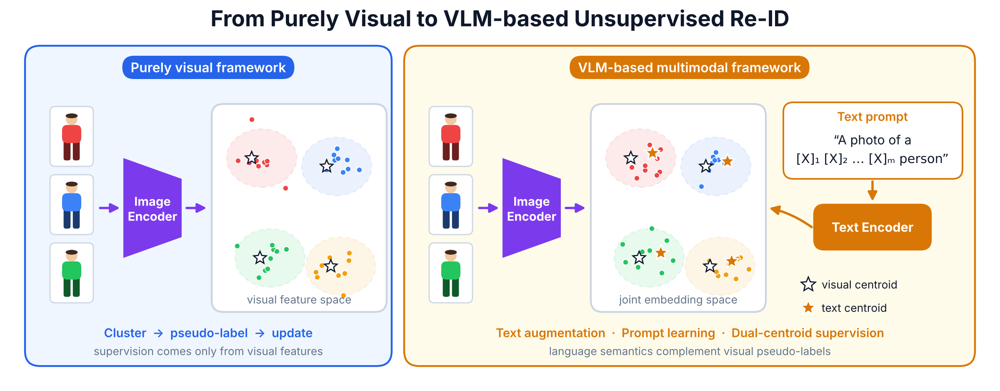</p>

<table>
<tr>
<th width="50%">✍️ Text Augmentation</th>
<th width="50%">💬 Prompt Learning</th>
</tr>
<tr valign="top">
<td>

| Method | Task |
|:--|:--:|
| **MUMA** | Text → Image |
| **LVLM-AAM** | VIS ↔ IR |
| **FIRM** | VIS ↔ IR |
| **CANC** / **ECCA** | Text → Image |
| **CCL** / **WIN** | Text → Image |

</td>
<td>

| Method | Task |
|:--|:--:|
| **CLIP-ReID** [](https://github.com/Syliz517/CLIP-ReID) | Image (sup. basis) |
| **CCLNet** | VIS ↔ IR |
| **VLUReID** | Video |
| **ViewCoOp** | Vehicle |
| **TGMRL** | VIS ↔ IR |
| **ICSM** | Clothing-change |
| **ITSL** | Cross-resolution |
| **Partial-wise Prompts** | Image |
| **Day-Night Prompts** | Vehicle |

</td>
</tr>
</table>

#### 🧪 Illustrative Experiment · Visual-Textual Dual Centroids

> Backbone: **CLIP ViT-B/16** · Setting: **USL** · Loss: **ClusterNCE** on both centroids · Prompt: `"A photo of [CLS] person"`

<p align="center">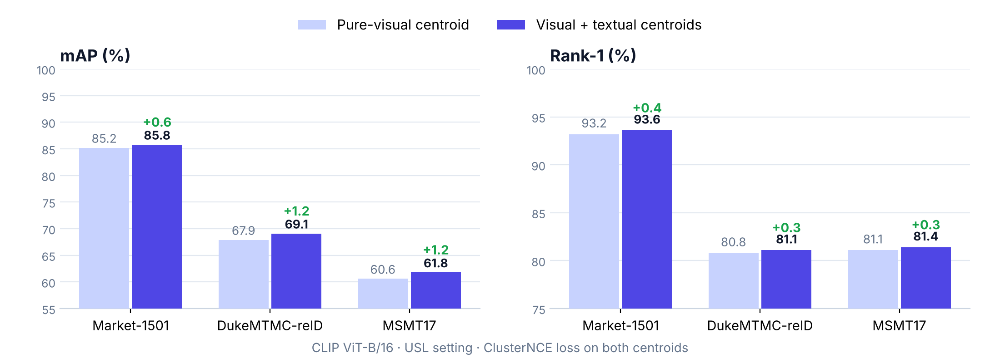</p>

<div align="center">

| Dataset | Method | mAP | Rank-1 | Rank-10 |
|:--:|:--|:--:|:--:|:--:|
| **Market-1501** | Pure-visual | 85.2 | 93.2 | 98.2 |
| | 🌟 **Visual + Textual** | **85.8** <sub>🔺0.6</sub> | **93.6** <sub>🔺0.4</sub> | **98.5** <sub>🔺0.3</sub> |
| **DukeMTMC-reID** | Pure-visual | 67.9 | 80.8 | 90.4 |
| | 🌟 **Visual + Textual** | **69.1** <sub>🔺1.2</sub> | **81.1** <sub>🔺0.3</sub> | **91.1** <sub>🔺0.7</sub> |
| **MSMT17** | Pure-visual | 60.6 | 81.1 | 90.5 |
| | 🌟 **Visual + Textual** | **61.8** <sub>🔺1.2</sub> | **81.4** <sub>🔺0.3</sub> | **90.5** <sub>±0.0</sub> |

</div>

<p align="right"><a href="#top">🔝 Back to top</a></p>

---

## 🗃️ Datasets

<p align="center">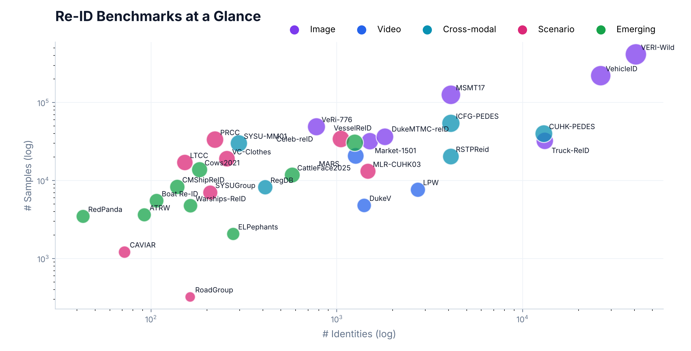</p>

<details open>
<summary><b>👤🚗 Person & Vehicle Datasets</b></summary>
<br/>

| Category | Dataset | Year | Samples | IDs | Object |
|:--:|:--|:--:|--:|--:|:--:|
| 🖼️ **Image** | Market-1501 | 2015 | 32,217 | 1,501 | 👤 |
| | DukeMTMC-reID | 2017 | 36,441 | 1,812 | 👤 |
| | MSMT17 | 2018 | 126,441 | 4,101 | 👤 |
| | VehicleID | 2016 | 221,763 | 26,267 | 🚗 |
| | VeRi-776 | 2016 | 49,357 | 776 | 🚗 |
| | VERI-Wild | 2019 | 416,314 | 40,671 | 🚗 |
| | Truck-ReID | 2023 | 32,353 | 13,137 | 🚚 |
| 🎞️ **Video** | MARS | 2016 | 20,715 | 1,261 | 👤 |
| | LPW | 2018 | 7,694 | 2,731 | 👤 |
| | DukeMTMC-VideoReID | 2018 | 4,832 | 1,404 | 👤 |
| 📝 **Image-Text** | CUHK-PEDES | 2017 | 40,206 / 80,422 | 13,003 | 👤 |
| | ICFG-PEDES | 2021 | 54,522 / 54,522 | 4,102 | 👤 |
| | RSTPReid | 2021 | 20,505 / 41,010 | 4,101 | 👤 |
| 🌗 **VIS-IR** | RegDB | 2017 | 4,120 / 4,120 | 412 | 👤 |
| | SYSU-MM01 | 2017 | 20,284 / 9,929 | 296 | 👤 |
| 👕 **Cloth-Changing** | PRCC | 2019 | 33,698 | 221 | 👤 |
| | Celeb-reID | 2019 | 34,186 | 1,052 | 👤 |
| | Celeb-reID-light | 2019 | 10,842 | 590 | 👤 |
| | VC-Clothes | 2020 | 19,060 | 256 | 👤 |
| | LTCC | 2020 | 17,119 | 152 | 👤 |
| 🔍 **Cross-Resolution** | CAVIAR | 2011 | 1,220 | 72 | 👤 |
| | MLR-CUHK03 | 2014 | 13,164 | 1,467 | 👤 |
| | D-Market-1501 | 2024 | 32,668 | 1,501 | 👤 |
| 👥 **Group** | RoadGroup | 2019 | 324 | 162 | 👥 |
| | SYSUGroup | 2020 | 7,071 | 208 | 👥 |

</details>

<details open>
<summary><b>🚢🐯 Vessel & Animal Datasets</b></summary>
<br/>

| Dataset | Year | Images | IDs | Species | Modality | Source |
|:--|:--:|--:|--:|:--:|:--:|:--|
| Boat Re-ID | 2019 | 5,523 | 107 | 🚢 Vessel | RGB | Coastal camera |
| VesselReID | 2023 | 30,587 | 1,248 | 🚢 Vessel | RGB | Ship spotting website |
| Warships-ReID | 2023 | 4,780 | 163 | 🚢 Vessel | RGB | Ship imaging website |
| CMShipReID | 2025 | 8,337 | 138 | 🚢 Vessel | VIS / NIR / TIR | UAV capture |
| HolsteinCattleRecog | 2018 | 1,237 | 136 | 🐄 Holstein | RGB + Thermal | Milking parlor |
| ATRW | 2019 | 3,649 | 92 | 🐯 Amur tiger | RGB (video) | Camera traps / zoos |
| ELPephants | 2019 | 2,078 | 276 | 🐘 Elephant | RGB | Wildlife sanctuaries |
| YakReID-103 | 2021 | 2,247 | 103 | 🐂 Yak | RGB | Outdoor farm |
| Cows2021 | 2021 | 13,784 | 182 | 🐄 Cattle | RGB (video) | Overhead cameras |
| RedPanda | 2025 | 3,487 | 43 | 🐼 Red panda | RGB | Enclosure cameras |
| CattleFace2025 | 2025 | 11,880 | 574 | 🐄 Holstein & Simmental | RGB | Ranch cameras |
| ThresherShark | 2025 | – | – | 🦈 Thresher shark | RGB (video) | Diver-held cams |
| HolsteinFriesianCrowd | 2026 | 524,469 | – | 🐄 Holstein | RGB | Farm CCTV |

</details>

### 📏 Evaluation Metrics

| Metric | Description |
|:--:|:--|
| **CMC / Rank-k** | Fraction of queries with a correct match in the top-*k* results |
| **mAP** | Mean of query-level Average Precision over all relevant gallery samples |
| **mINP** | Mean Inverse Negative Penalty — $\mathrm{INP}_i = N_i^+ / r_i^{\mathrm{last}}$, measures how early the *last* correct match appears |

<p align="right"><a href="#top">🔝 Back to top</a></p>

---

## 🔭 Future Directions

<p align="center">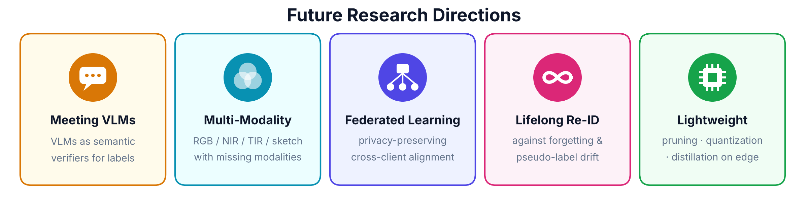</p>

| Direction | Key open problem |
|:--|:--|
| 🧠 **Meeting VLMs** | Use VLMs as dynamic *semantic verifiers* for pseudo-label correction, not only as feature extractors |
| 🌈 **Multi-Modality** | Cluster by identity rather than by sensor across RGB / NIR / TIR / sketch, with arbitrary missing modalities |
| 🔒 **Federated Learning** | Cross-client pseudo-label alignment and fairness-aware aggregation beyond size weighting |
| ♾️ **Lifelong Re-ID** | Avoid catastrophic forgetting *and* pseudo-label drift on continuous unlabeled streams |
| ⚡ **Lightweight Deployment** | Compact backbones, pruning, quantization and distillation for edge devices |

---

## 📝 Citation

If you find this survey or repository helpful, please consider giving a ⭐ and citing:

```bibtex
@article{unsupervised_reid_survey_2026,
  title   = {Unsupervised Object Re-Identification: Recent Advances, Challenges, and Future Directions},
  author  = {Author One and Author Two and Author Three},
  journal = {arXiv preprint arXiv:XXXX.XXXXX},
  year    = {2026}
}
```

---

## 🤝 Contributing

We warmly welcome contributions! If you find a missing paper, a wrong venue, or a new code release:

1. Fork this repo and add your entry in the matching section using the format below;
2. Open a Pull Request — or simply raise an [Issue](../../issues).

```markdown
| **Method** | Paper Title |  | [](https://github.com/owner/repo) |
```

<details>
<summary><b>🎨 Regenerating the figures & demo video</b></summary>
<br/>

All figures in [`fig/`](fig) and the demo video are generated from code in [`scripts/`](scripts) (Python · Matplotlib · FFmpeg):

```bash
pip install matplotlib numpy pillow
python scripts/figs1.py fig          # banner, Re-ID process, settings, taxonomy, UDA, USL pipeline
python scripts/figs2.py fig          # scenarios, cross-modal, emerging, VLM, results, timeline, datasets, future
python scripts/video.py fig/_video   # renders 7 scenes → concat into fig/demo.mp4
```

</details>

## ✨ Star History

<div align="center">
<a href="https://star-history.com/#YOUR_ORG/Awesome-Unsupervised-ReID&Date">
  
</a>

<br/><br/>
<sub>Made with ❤️ by the authors · If this list helps you, a ⭐ means a lot!</sub>
</div>
